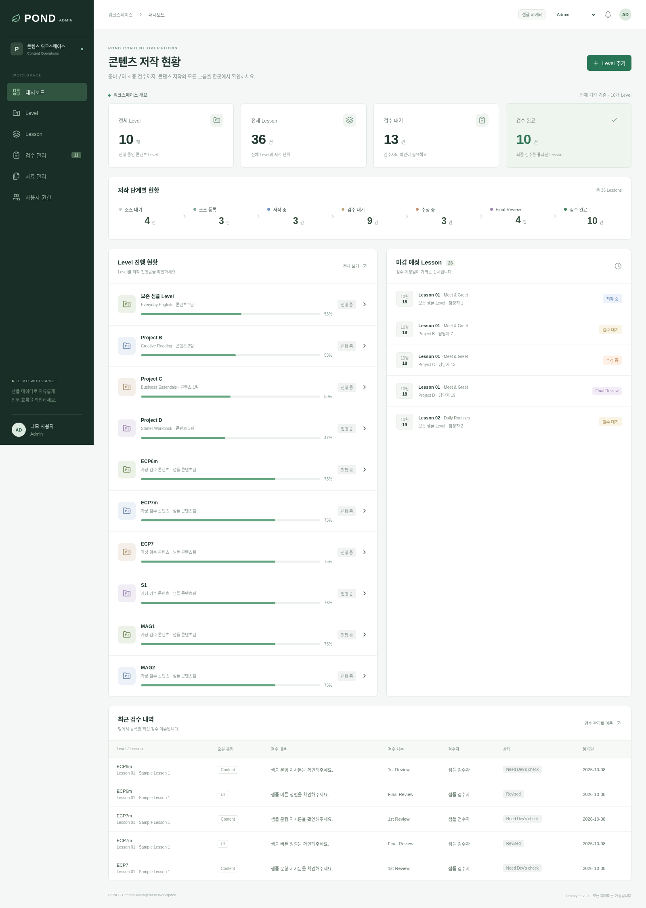
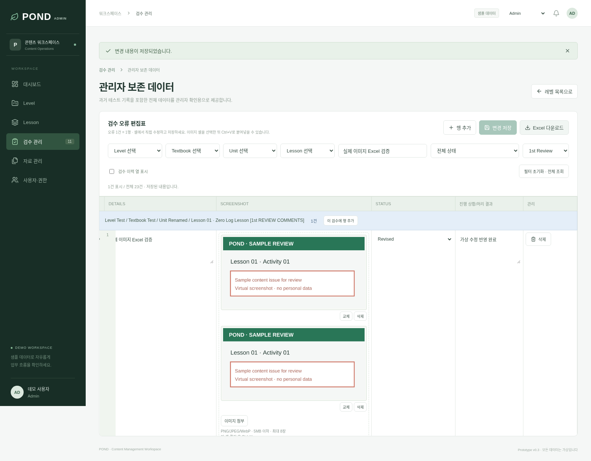
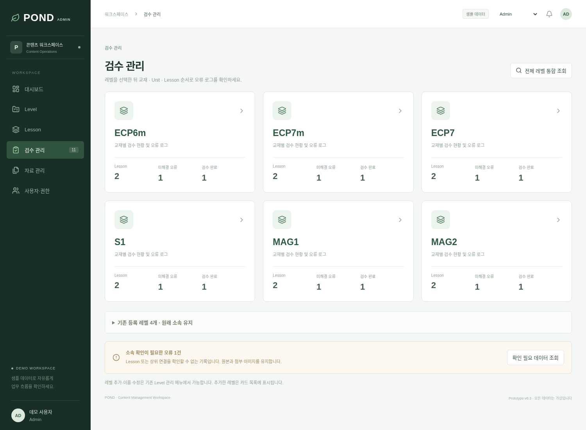
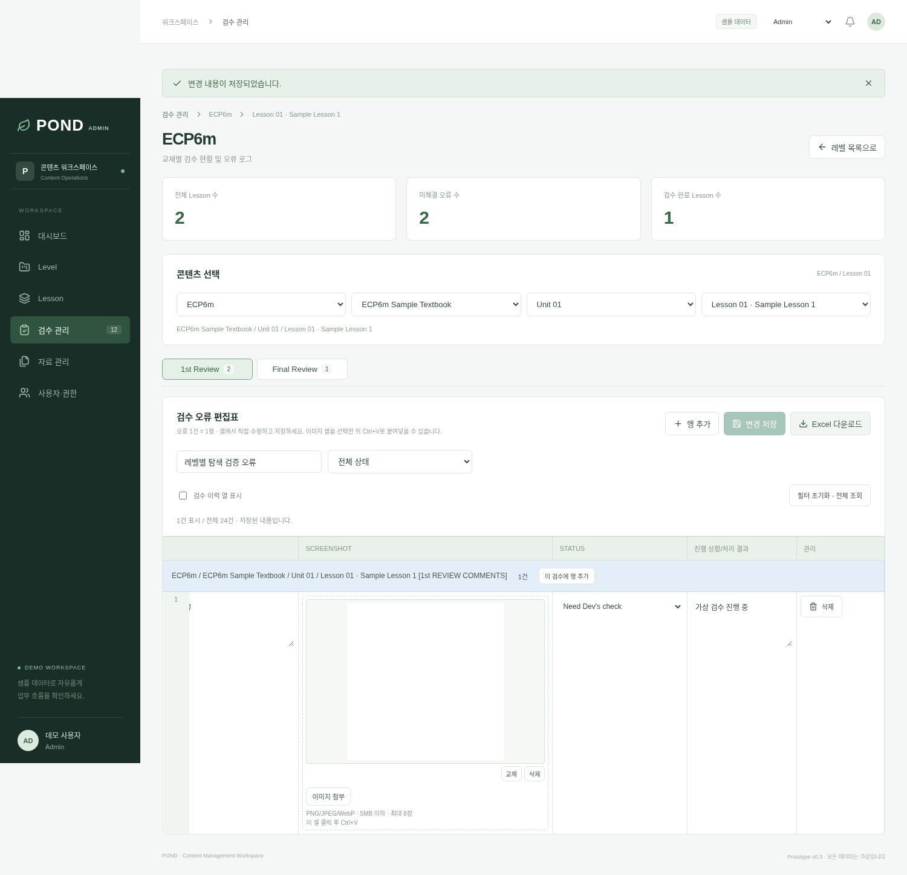
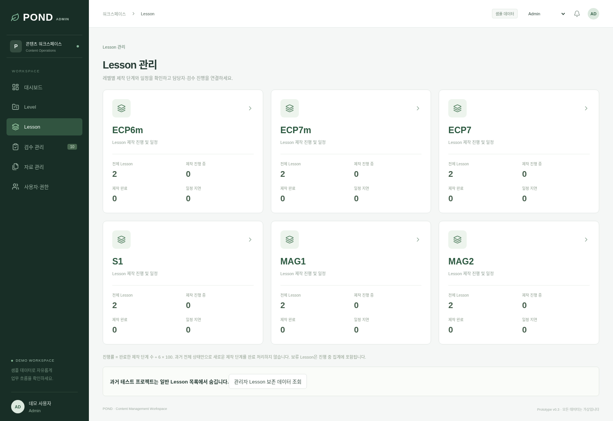
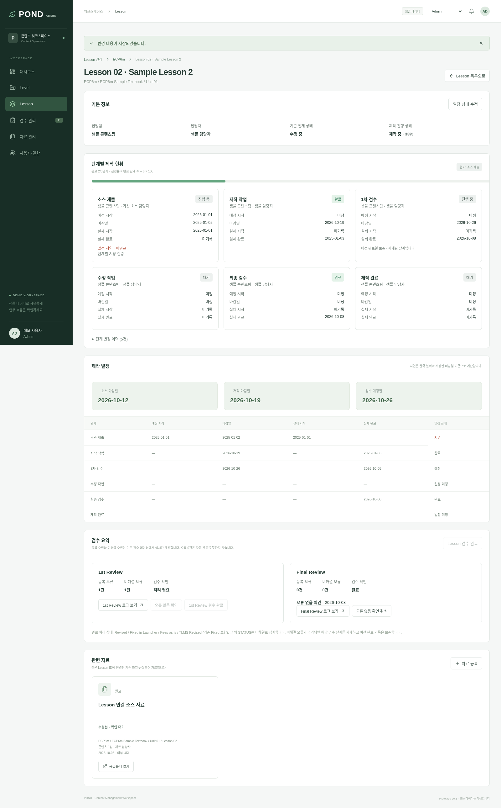
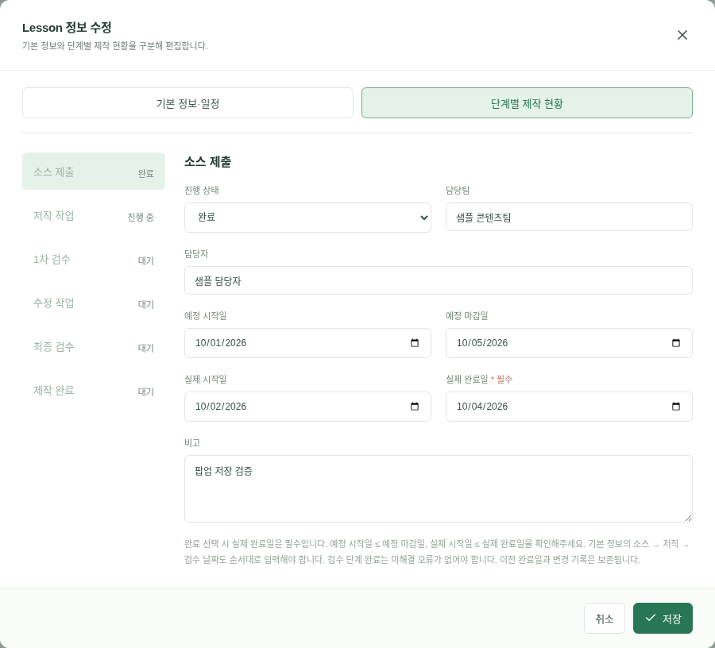

# POND 콘텐츠 제작·검수 Admin v0.3

Level → Textbook → Unit → Lesson을 기준으로 제작 일정, 자료, 검수 오류를 관리하는 한국어 웹 프로토타입입니다. 실제 회사 데이터·개인정보·비밀키·외부 데이터베이스를 사용하지 않습니다.

## 설치 없이 확인하기

`artifacts/POND-Admin.html`을 내려받아 브라우저에서 열면 앱을 사용할 수 있습니다. 단일 HTML에도 동일한 화면·이미지·Excel 기능이 들어 있습니다. 사이트 저장소를 차단하는 브라우저에서는 저장이 지원되지 않을 수 있습니다. 이 환경에서는 Codex 내부의 포트 미리보기 기능을 제공하지 않으므로 공개 사이트 링크는 없습니다.

## 개발 환경에서 실행

Node.js 22.12 이상(권장: 24)을 설치하고 저장소 폴더에서 다음 명령어를 순서대로 실행합니다.

```bash
npm ci
npm run dev
```

터미널에 표시된 주소를 브라우저에서 엽니다. 기본 포트는 5173입니다. 기존 체크아웃을 사용하며 별도 worktree는 필요하지 않습니다.

## 기존 데이터 보존

- 최초 실행 시 이전 버전의 `pond-v1` localStorage 데이터를 읽어 IndexedDB로 복사합니다. 이전 localStorage는 자동 삭제하거나 덮어쓰지 않습니다.
- 기존 프로젝트는 Level로 취급하며 **프로젝트명, ID, 담당자, 일정, 진행 상태를 보존**합니다. 그래서 이전 샘플의 이름이 `Project A`로 보일 수 있습니다. Level 수정으로 원하는 가상 레벨명으로 바꿀 수 있습니다.
- 각 기존 프로젝트의 과정명을 기본 Textbook으로, 기존 Lesson을 기본 `Unit 01`로 연결합니다. 기존 Lesson ID, 자료 파일·URL, 검수 ID·내역은 보존합니다.
- 기존 SCREENSHOT URL은 `legacyScreenshot` 필드로 보존하지만 새 표에는 URL 입력·링크를 제공하지 않습니다. 외부 이미지 자동 다운로드는 하지 않으므로 새 이미지 파일을 직접 첨부하세요.
- 이후 실행은 IndexedDB를 사용합니다. 마이그레이션은 중복 Textbook/Unit을 생성하지 않습니다. 새 Level 아래에는 사용자가 Textbook과 Unit을 추가합니다.
- 브라우저 주소·포트·프로필이 달라지면 저장소가 달라집니다. 기존 웹앱과 같은 주소·브라우저에서 실행해야 기존 브라우저 데이터를 읽을 수 있습니다. 내려받은 HTML과 개발 서버의 데이터는 서로 공유되지 않습니다.

## 사용 순서

### 1. 콘텐츠 계층 관리

사이드바 **Level**에서 왼쪽부터 Level, Textbook, Unit을 선택합니다. 각 단계에서 추가·수정·조회할 수 있습니다. Unit을 선택하면 해당 Unit에 Lesson을 추가합니다. Lesson 이름을 누르면 상세 화면으로 이동합니다.

Lesson 상세에서 일정·담당자·상태를 수정하거나 **Lesson 검수 완료**를 누릅니다. 검수 로그가 0건이어도 완료할 수 있습니다. 상세의 **Lesson 검수 확인**에서 1차·최종 각각 **오류 없음 확인**을 기록·취소할 수 있습니다. 오류 없음 확인은 Lesson 검수 완료와 별도 기록입니다. 해당 차수에 새 오류를 저장하면 오류 없음 확인은 해제되며 Lesson 완료 상태는 자동 변경하지 않습니다. 오류를 모두 삭제해도 오류 없음 확인이 자동 등록되지는 않습니다. Level 완료 처리는 하나 이상의 Lesson이 있고 모든 Lesson이 검수 완료일 때 가능합니다. 완료된 Level의 Lesson은 일정·상태 수정이 잠깁니다.

### 2. 엑셀 형태의 검수 표

**검수 관리**에서 오류를 발견했을 때만 **행 추가**를 누릅니다. 오류 1건이 1행입니다. Class/Activity나 Lesson별 빈 오류 행을 자동 생성하지 않습니다.

- Level → TEXTBOOK → UNIT → LESSON을 선택합니다. 상위 항목을 바꾸면 하위 선택이 초기화되므로 다시 선택해야 합니다.
- PIC, CLASS, ACTIVITY, 페이지 번호, DETAILS 등을 셀에서 직접 수정합니다. Class/Activity는 자유 입력이며 기존 값이 자동완성 후보로 표시됩니다.
- Lesson별 `[1st REVIEW COMMENTS]`는 파란 구분 행, `[Final REVIEW COMMENTS]`는 살구색 구분 행으로 표시합니다. 구분 행의 **이 검수에 행 추가**를 누르면 같은 Lesson·차수에 오류를 추가합니다. 오류가 없는 Class/Activity는 빈 행으로 표시하지 않습니다.
- ERROR TYPE과 STATUS는 선택형입니다. STATUS는 Revised, Fixed in Launcher, Need IT check, IT is in progress, Keep as is, Need Dev's check, Need to check on the smartboard, TLMS Revised를 지원합니다. 기존 Open/Fixed 등의 값은 강제로 바꾸지 않으며 `이전 상태`로 표시·필터할 수 있습니다.
- **진행 상황/처리 결과**는 담당자가 셀에 자유롭게 입력합니다. 기존 `처리 결과` 데이터 필드를 그대로 사용합니다.
- 검수 차수·검수자·등록일·수정자·수정일·재검수 결과는 **검수 이력 열 표시**를 켜면 편집·조회할 수 있습니다. 등록일·수정자·수정일은 저장 시 자동 기록합니다.
- **DETAILS, 연결 Lesson, 검수자**는 필수입니다. 오류가 없는 행은 삭제하세요.
- **변경 저장**으로 현재 표의 추가·수정·삭제를 저장합니다. 필터에 가려진 행의 변경도 같이 저장됩니다. 행 삭제는 확인 후 저장해야 확정됩니다.
- 저장하지 않은 변경이 있을 때 화면 이동·새로고침 전에 경고합니다. 이동을 승인하면 미저장 변경은 버려집니다.
- 조회 필터는 계층, Lesson, 상태, 1st Review/Final Review를 지원합니다. 가로·세로 스크롤로 모든 컬럼을 확인할 수 있습니다.

기본 검수 컬럼: PIC, TEXTBOOK, UNIT, LESSON, CLASS, ACTIVITY, TEXTBOOK PAGE NO., ERROR TYPE, DETAILS, SCREENSHOT, STATUS, 진행 상황/처리 결과. Level은 TEXTBOOK 셀 안의 상위 선택으로 연결하며 별도의 Class·Activity 관리 단계는 없습니다. 전체 조회에서 모든 Level의 오류를 통합 확인할 수 있습니다.

### 3. 스크린샷

SCREENSHOT 셀의 **이미지 첨부**로 PNG/JPEG/WebP 파일을 여러 장 선택하거나, 이미지 셀을 클릭해 포커스를 두고 **Ctrl+V**(macOS는 Cmd+V)로 클립보드 이미지를 붙여넣습니다. 텍스트나 파일 경로가 아닌 실제 이미지가 클립보드에 있어야 합니다.

첨부 즉시 셀에 실제 이미지가 나타납니다. 이미지를 클릭하면 확대되며 각 이미지 아래에서 교체·삭제할 수 있습니다. 행당 최대 8장, 원본 파일 개별 5MB 이하를 지원합니다. 셀 표시용 이미지는 비율을 유지하며 긴 변이 1200px를 넘으면 PNG 미리보기를 축소합니다. 새 첨부 파일은 원본도 별도로 저장하며, 클릭 확대는 원본 픽셀 크기로 표시하고 스크롤·원본 다운로드를 지원합니다. 이전 버전에 이미 축소 저장한 이미지의 원본 해상도는 복원할 수 없습니다. 업로드가 끝난 뒤 **변경 저장**을 눌러야 새로고침 후에도 유지됩니다. 샘플 이미지만 사용하세요.

### 4. Excel 다운로드

저장 후 **Excel 다운로드**를 누르면 현재 조회 조건의 오류를 `.xlsx`로 다운로드합니다. Lesson 상세에서는 해당 Lesson만, Level 관리의 **Level Excel**에서는 해당 Level의 오류를 내려받습니다.

스크린샷은 URL이나 텍스트가 아니라 **실제 이미지 객체**로 SCREENSHOT 열의 해당 행에 삽입됩니다. 화면과 같은 Lesson·차수별 색상 구분 행을 내보냅니다. 여러 장은 해당 오류 행의 SCREENSHOT 열에 세로로 배치하며 비율을 유지하고 행 높이·열 너비를 늘립니다. PNG/JPEG는 보존된 원본을 사용하고 Excel이 지원하지 않는 WebP는 PNG 미리보기로 내보냅니다. 기존 검수자·수정 이력은 별도 `검수 이력` 시트에 함께 보존합니다. Excel에서 보이는 이미지 크기는 표 렌더러에 따라 조금 달라질 수 있습니다. 이미지를 개별 행에 고정 배치하는 방식이며 Excel의 최신 IMAGE 함수는 사용하지 않습니다.

### 5. 유지된 기능

- 대시보드: Level 수, Lesson 수, 단계별 현황, 평균 진행률, 최근 검수, 마감 예정 Lesson.
- 자료: 유형별 조회, 파일 첨부(개별 2MB 이하), 공유폴더/외부 문서 URL 등록·열기. Level/Textbook/Unit/Lesson에 연동한 조회·등록.
- 권한: Admin, Source Team, Authoring Team, QA Reviewer. 모두 메뉴를 조회할 수 있으며 작업 버튼과 셀 편집은 데모 역할별로 제한합니다. 상단 역할 선택으로 전환하세요.
- 샘플 데이터 초기화: Admin만 실행할 수 있으며 명시적 확인 후 현재 IndexedDB 데이터를 초기화합니다. 초기화 전 데이터는 자동 백업되지 않으므로 필요한 검수는 Excel로 내려받으세요. 이전 v1 백업은 보존됩니다.

진행률은 Lesson의 7단계 상태 위치를 백분율로 환산한 평균입니다. 대시보드 검수 대기 카드에는 Final Review가 포함되며 단계별 현황에서는 따로 표시합니다.

## 저장 한계와 미구현 사항

모든 데이터·이미지·자료 첨부는 현재 브라우저의 **IndexedDB**에 저장합니다. 서버에 업로드하지 않습니다. 저장 트랜잭션이 성공한 뒤 화면에 저장 완료를 표시하며 실패하면 오류 안내를 제공합니다. IndexedDB 접근이 불가능하면 기존 데이터를 보호하기 위해 편집을 시작하지 않습니다.

용량 한도는 브라우저·기기 여유 공간에 따라 달라집니다. 이미지가 많거나 PNG 변환 결과가 크면 저장 공간 부족으로 실패할 수 있습니다. 사이트 데이터 삭제, 브라우저 초기화, 저장소 정리, 시크릿 모드 종료로 데이터가 사라질 수 있습니다. 새 기기·브라우저·주소 사이의 동기화, 자동 백업·복원, 다중 탭의 동시 편집 충돌 해결은 제공하지 않습니다. 업무 원본 저장용으로 사용하지 마세요.

실제 로그인·서버 권한 검증, 사용자 계정/권한 편집, 회사 시스템 연동, 대용량 업로드, 알림, Excel 가져오기, 자동 승인 흐름은 미구현입니다. 역할 전환은 UI 데모이며 실제 보안 장치가 아닙니다.

## 빌드와 검증

```bash
npm run lint
npm test
npm run build
npm run build:html
npm run preview
```

`npm run build`는 `dist/`, `npm run build:html`은 설치 없이 여는 단일 HTML을 생성합니다. Excel 모듈은 일반 웹 빌드에서 다운로드할 때 로딩합니다. 빌드의 Excel 청크 크기 경고는 실행 실패가 아닙니다.

브라우저 검사는 `/usr/bin/chromium`이 설치된 Linux 환경에서 실행합니다. 개발 서버를 먼저 5173 포트로 시작하세요.

```bash
npm run test:browser
# 다른 포트를 사용할 때
POND_TEST_URL=http://localhost:5174/ npm run test:browser
```

검사는 별도의 테스트 브라우저에서 v1 마이그레이션, 계층 생성·수정, 0건 Lesson 완료·오류 없음 확인, Lesson별 색상 구분 행·8개 STATUS·이전 STATUS 보존, 셀 편집, 다중 이미지·붙여넣기·교체·삭제·확대·저장 복원, 실제 Excel 이미지, 필터, 자료·권한을 확인합니다. 테스트 사용 데이터는 모두 가상입니다.

## 주요 파일

- `src/main.jsx`, `src/style.css`: 기존 대시보드·Lesson·자료·권한과 공통 레이아웃.
- `src/Hierarchy.jsx`: 콘텐츠 계층 관리와 상위 연동 선택.
- `src/ReviewGrid.jsx`: 직접 편집 검수 표와 이미지 셀.
- `src/model.js`: 데이터, 호환 마이그레이션, 계층·권한·진행률.
- `src/storage.js`: IndexedDB 저장과 v1 이전.
- `src/images.js`, `src/excel.js`: 이미지 읽기·축소 및 실제 이미지 포함 Excel.
- `src/model.test.js`, `tests/smoke.mjs`: 기본·브라우저 검증.
- `scripts/build-html.mjs`, `artifacts/POND-Admin.html`: 단일 HTML 생성 및 결과물.
- `package.json`, `package-lock.json`, `vite.config.js`, `eslint.config.js`, `index.html`, `.gitignore`: 실행·빌드·검사 설정.





## 스크린샷 기준의 적용 범위

현재 채팅에 실제 Excel 스크린샷 파일이 전달되지 않아 사진과의 픽셀 단위 일치 여부는 검증하지 못했습니다. 요청한 컬럼·행 중심 편집·Lesson별 검수 구분·상태 목록을 기준으로 구성했습니다. 검수 데이터와 이미지 내보내기는 실제 브라우저 및 Excel 파일 파싱으로 검증합니다.

## 단계별 개발

1단계 검수 관리는 main에 병합되었고, 이번 작업 범위는 **2단계 Lesson 관리 및 제작 일정**입니다. 자료·대시보드·사용자 권한의 다음 단계 개발은 화면 확인과 승인 후 진행합니다. 범위와 공통 ID 연결, 기존 메뉴 보존 원칙은 [단계별 개발 문서](docs/development-stages.md)에 정리했습니다.

## 검수 관리 레벨 탐색 업데이트

검수 관리 첫 화면은 ECP6m, ECP7m, ECP7, S1, MAG1, MAG2 카드입니다. 카드의 Lesson 수·미해결 오류 수·검수 완료 수는 실제 저장된 데이터를 집계합니다. 미해결 오류는 Revised, Fixed in Launcher, Keep as is, TLMS Revised 및 이전 Fixed를 제외한 상태입니다.

레벨을 누르면 **교재 → Unit → Lesson**을 선택합니다. 상위 선택 변경 시 하위 값이 초기화되고, Lesson을 선택해야 편집표가 나옵니다. **1st Review / Final Review 탭**에서 각각의 기록을 확인·추가·저장합니다. 저장하지 않은 변경이 있으면 콘텐츠·차수·화면 이동 전에 확인합니다. 전체 조회에서는 기존처럼 모든 차수의 기록을 검색·수정하고 Excel로 내보낼 수 있습니다.

초기 6개 Level은 공통 관리 데이터에 한 번만 추가됩니다. 신규로 생성한 초기 레벨에는 탐색 테스트용 가상 교재·Unit·Lesson·오류 데이터가 추가되며, 원래 데이터는 옮기거나 이름을 바꾸지 않습니다. 이미 같은 이름의 Level이 있으면 그 데이터를 사용하며 샘플 콘텐츠를 추가하지 않습니다. 따라서 실제 내용에 따라 통계는 0일 수도 있습니다. 관리자 이름 수정은 초기 목록 재생성으로 덮어쓰지 않습니다. Level 메뉴에서 새로 추가한 레벨도 검수 관리 카드 목록에 표시됩니다.

- 기존 Project A~D 등 과거 Level은 일반 카드·Level 드롭다운·일반 통합 조회에서 숨깁니다. Admin은 **관리자 보존 데이터 조회**에서 전체 원본을 확인할 수 있습니다. 새로운 6개 Level에 자동 배정하거나 삭제하지 않습니다.
- 연결된 Lesson 또는 상위 엔터티를 찾을 수 없거나 기존 `projectId`와 Textbook의 Level ID가 다른 로그는 **소속 확인 필요** 화면에 표시합니다. 원문·이미지는 유지하며 명시적으로 연결값을 선택한 행만 수정합니다.
- 다른 정상 오류의 저장 때문에 연결이 불명확한 기존 로그를 삭제하거나 바꾸지 않습니다. 누락된 등록일이 있어도 기존 메뉴가 중단되지 않도록 날짜 정렬만 방어 처리했습니다.
- **전체 레벨 통합 조회**에서는 알려진 레벨과 소속 확인 필요 로그를 함께 조회할 수 있습니다.
- **레벨 목록으로** 버튼으로 카드 화면에 돌아갑니다. 검수 화면 이동은 전체 페이지를 새로 로드하지 않습니다. 새로고침 후 데이터·이미지는 유지되며, 탐색 선택은 기본 카드 화면에서 다시 선택합니다.

전용 탐색 검증은 서버 시작 후 `npm run test:navigation`으로 실행합니다. 검수 카드·통계·연동·차수별 CRUD·이미지·Excel·새로고침·미분류 기록 보존·다른 메뉴를 확인합니다.




## 일반 Level 목록 및 Excel 출력 서식

검수 카드와 드롭다운은 동일한 공통 목록을 사용합니다. 기본 순서는 ECP6m → ECP7m → ECP7 → S1 → MAG1 → MAG2이며, 관리자가 이후 추가한 레벨은 그 뒤에 표시합니다. 과거 Project A~D 등 보존 대상으로 분류한 레벨은 Level 관리에 원본을 유지하되 일반 검수 목록에서는 제외합니다.

Excel의 검수 로그 시트는 **각 Lesson·차수마다 제목 → 헤더 → 오류 데이터**를 반복합니다. 첫 블록의 1행은 전체 12열 병합 제목, 2행은 PIC 등 컬럼 헤더, 3행부터 오류입니다. 제목은 왼쪽 정렬·흰색 굵은 글씨이며 1st Review는 파란색, Final Review는 보라색입니다. 헤더는 연한 녹색입니다. 데이터 셀에는 테두리·줄바꿈을 적용하며 STATUS와 처리 결과는 그대로 출력합니다. 웹 검수표의 구분 행이나 컬럼 배치는 변경하지 않습니다.

이미지는 SCREENSHOT 열에 실제 이미지로 배치하며 비율을 유지합니다. Excel 최대 행 높이(409.5pt)를 고려해 여러 장은 같은 행의 세로 슬롯 안에 축소하여 겹침을 방지합니다. 8장처럼 이미지가 많으면 작게 보일 수 있으며, 아주 긴 텍스트는 Excel의 행 높이 한도 때문에 셀을 선택해 내용을 확인해야 할 수 있습니다. 원본 로그와 이미지 데이터는 내보내기 과정에서 변경하지 않습니다.

## 2단계: Lesson 관리 및 제작 일정

왼쪽 **Lesson** → **ECP6m** → 교재·Unit·Lesson 선택 → Lesson 행 클릭 순서로 확인하세요. 초기 6개 레벨과 Level 관리에서 추가한 레벨을 같은 공통 목록으로 조회합니다. 과거 Project A~D와 연결이 불명확한 Lesson은 일반 목록에서 숨기지만 원본을 보존하며, Admin의 **관리자 Lesson 보존 데이터 조회** 또는 기존 Level 관리에서 확인할 수 있습니다.

카드의 전체·제작 진행 중·제작 완료·일정 지연 건수는 실제 Lesson과 단계 데이터에서 계산합니다. 제작 진행 중에는 보류 상태도 포함합니다. **진행률 = 완료된 단계 수 / 6 × 100**(반올림)입니다. 소스 제출, 저작 작업, 1차 검수, 수정 작업, 최종 검수, 제작 완료를 독립적으로 관리합니다. 제작 완료 단계는 앞선 5단계가 완료된 경우에만 완료할 수 있습니다.

**일정·상태 수정** 창은 기본 정보·일정 / 단계별 제작 현황 탭으로 구분합니다. 단계 하나를 선택해 상태, 담당팀·담당자, 예정 시작·마감·실제 시작·실제 완료일, 비고를 편집합니다. 날짜는 달력 입력이며 완료에는 실제 완료일이 필요합니다. 날짜 순서, 같은 Unit의 Lesson 번호 중복, 상위 연결, 미해결 검수 오류 등을 검증합니다. 저장 실패 시 창과 입력 내용을 유지합니다. 저장하지 않은 Lesson 편집을 닫거나 화면을 이동하면 확인합니다.

기존 소스·저작·검수 예정일과 `lessons[].status`는 그대로 보존하며, 새 단계의 마감일 기본값에 기존 일정 3개를 사용합니다. 기본 일정과 단계 일정은 이후 각각 편집합니다. 과거 전체 상태가 검수 완료여도 소스·저작 등 새 단계 완료를 추정하지 않습니다. 기존 차수별 명시적인 오류 없음 기록은 해당 검수 단계의 근거로 사용합니다. **지연**은 한국 시간(Asia/Seoul)의 오늘보다 마감일이 빠르고 단계가 완료되지 않은 경우입니다. 실제 저장 일정을 자동으로 이동시키지 않습니다.

### 검수 연동 규칙

- 검수 요약은 같은 `lessonId`의 실제 오류에서 차수별 전체·미해결 건수를 계산합니다. 별도 수동 입력값은 없습니다.
- 완료 처리된 오류 STATUS: **Revised / Fixed in Launcher / Keep as is / TLMS Revised**, 호환용 이전 **Fixed**. 나머지 기존 8개 STATUS 중 4개와 알 수 없는 이전 값은 미해결입니다. 검수표의 STATUS 목록과 Excel 모듈은 바꾸지 않습니다.
- 오류 0건은 ‘확인 대기’입니다. **오류 없음 확인** 또는 차수별 **검수 완료**를 명시적으로 눌러야 해당 검수 단계가 완료됩니다. 미해결이 있으면 완료를 차단합니다.
- 각 차수의 명시적 완료는 해당 제작 검수 단계와 연결합니다. 두 차수가 모두 확인되면 전체 Lesson 검수 완료를 기록하지만, 이것이 소스·저작·수정·제작 완료 단계의 자동 완료는 아닙니다.
- 새 단계 관리가 있는 Lesson에 미해결 오류가 생기면 해당 검수 단계는 진행 중으로 재개되고, 제작 완료 단계가 완료였다면 보류됩니다. 이전 실제 완료일·단계 변경 이력·이전 Lesson 완료 상태 기록을 보존합니다. 저작 완료 등 다른 단계는 유지합니다. 오류가 모두 해결되거나 삭제되어도 자동으로 다시 완료하지 않습니다.
- 기존 단계 관리가 없는 과거 Lesson의 전체 상태는 검수 저장만으로 바꾸지 않습니다. 이전 상태와 새 제작 상태는 따로 보여주므로 담당자가 새 단계 현황을 확인할 수 있습니다.
- **1st Review / Final Review 로그 보기**는 기존 검수 메뉴의 해당 Level·Textbook·Unit·Lesson과 차수로 이동합니다. 검수표·이미지·Excel 출력 서식은 기존 구현을 그대로 사용합니다.

### 자료 연결 및 저장 한계

기존 자료는 같은 Lesson ID로 연결하고 파일 다운로드·공유폴더 링크를 유지합니다. 추가 필드 `category`(소스 자료/저작 작업 파일/수정본/최종본/기타 참고 자료), `materialStatus`(등록/확인 대기/확인 완료/수정 필요)를 등록할 수 있으며, 기존에 없는 값은 ‘미지정’으로 표시합니다. 제출 현황, 버전 관리 및 자료 메뉴 본격 개편은 3단계 범위입니다.

새 데이터는 기존 IndexedDB 저장소의 Lesson 객체에 `production.stages`, `productionHistory`, `reviewConfirmations`, `legacyCompletionHistory`로 저장합니다. ID·로그·이미지·자료·URL과 알 수 없는 기존 확장 필드를 유지합니다. 새로고침 후 데이터는 복원되지만 화면의 선택값은 기본 화면부터 다시 선택합니다. 브라우저/주소/기기가 바뀌면 저장소가 달라지고, 사이트 데이터 삭제·시크릿 모드 종료·저장 용량 부족에 따라 데이터가 사라질 수 있습니다. 다중 사용자·다중 탭 동시 편집, 서버 백업, 실제 인증은 지원하지 않습니다. HTML 파일을 직접 열 때의 IndexedDB 허용 여부는 브라우저 정책에 따릅니다.

### 검증과 변경 파일

```bash
npm run test:lessons
```

개발 서버가 실행된 상태에서 Lesson 카드·계층 초기화·검색·상세 배치·단계 편집·검증·담당자와 일정·지연·검수 재개·0건 명시 확인·자료 링크·저장 복원·권한·기존 메뉴를 검사합니다. `npm test`는 모델 및 이미지 포함 Excel 출력 검증을, `test:browser`와 `test:navigation`은 기존 검수 회귀 검사를 수행합니다. Excel은 생성 파일을 파싱하여 이미지 위치·비율·행 높이·색상을 검증하며 데스크톱 Excel 앱의 육안 검사는 별도입니다.

- `src/LessonBrowser.jsx`, `LessonDetail.jsx`, `LessonEditor.jsx`: Lesson 탐색·상세·탭 편집 화면.
- `src/lesson-model.js`, `lesson-model.test.js`: 제작 단계·통계·일정·검수 연동 및 보존 규칙.
- `src/main.jsx`, `ReviewBrowser.jsx`, `style.css`: 화면 연결·검수 직접 이동·Lesson 스타일.
- `tests/lesson-navigation.mjs`, `tests/smoke.mjs`, `package.json`: 추가 기능 및 회귀 검사.
- `README.md`, `docs/development-stages.md`, `docs/lesson-*.png`: 사용법·범위·화면 예시.
- `artifacts/POND-Admin.html`: 최신 단일 HTML(다운로드 후 브라우저에서 열기, 별도 설치 없음).




### Lesson 정보 수정 팝업 보완

탭에는 동일한 좌우 여백을 적용하고 좁은 화면의 가로 넘침을 방지했습니다. 단계 입력은 진행 상태/담당팀 → 담당자 → 예정 시작일/예정 마감일 → 실제 시작일/실제 완료일 → 비고 순서입니다. 화면의 ‘예정 마감일’은 기존 `deadline` 필드에 연결하며 다른 날짜 저장 키도 그대로입니다. 좁은 화면에서는 날짜를 1열로 표시합니다.

**완료 선택 시 실제 완료일은 필수**입니다. 예정·실제 날짜 각각의 순서와 기본 제작 일정의 소스→저작→검수 순서도 확인합니다. 검수 단계의 미해결 오류 차단 조건은 유지합니다. 브라우저 기본 유효성 검사에 의해 저장 이벤트가 조용히 차단되지 않도록 팝업에서 명시적으로 검사하며, 오류 안내로 스크롤·포커스를 이동합니다. 저장 호출이 성공을 반환한 경우만 닫고, 저장 실패·예외 시 입력을 유지하며 메시지를 표시합니다.

서버 실행 후 `npm run test:lesson-editor`로 탭 경계·여백·전환, 2열/1열 날짜 배치, 소스 대기→완료 저장·닫힘·상세 반영·새로고침·변경 이력, 실제 완료일 누락, 저장소 용량 실패 주입 및 재시도, 다른 단계 수정, 미해결 검수 차단을 검사합니다. 실제 사용자 브라우저의 원래 오류 원인은 해당 저장 데이터 없이 확정하지 않았습니다. 정상·실패 상황은 가상 데이터와 Chromium에서 검증했고, 다른 브라우저의 달력 모양은 미검증입니다.



### 긴급 저장 오류 수정: 변경 범위에 따른 검증

이전 `validateLesson`은 소스 제출 하나만 수정해도 6개 단계와 기본 정보 전체를 검사했습니다. 따라서 기존에 다른 단계가 ‘완료’이지만 실제 완료일이 누락된 경우, 소스 제출의 날짜가 올바르더라도 해당 타 단계 오류로 저장이 차단됐습니다. ECP6m Lesson 01에 이 기존 상태를 넣은 별도 테스트 브라우저에서 수정 전 HTML의 차단을 실제 재현했습니다. 사용자 브라우저의 저장 데이터 자체를 읽은 것은 아닙니다.

편집 창은 현재 저장 데이터와 초안을 비교하여 **실제로 변경한 단계 모두**를 검사합니다. 탭을 여러 번 바꿔 여러 단계를 수정했다면 해당 단계들은 모두 검사합니다. 기본 정보가 변경되거나 신규 Lesson일 때는 기존 기본 필수값·날짜·계층 검증을 유지합니다. 미변경 단계의 선택 날짜 누락 또는 기존 누락 완료일은 독립 단계 저장을 막지 않으며 자동으로 보정·삭제하지 않습니다. 해당 단계를 편집하면 실제 완료일 및 날짜 순서를 다시 검사합니다. 미해결 검수 완료 차단과 앞선 5단계가 완료돼야 제작 완료할 수 있는 조건은 유지합니다.

`saveLessonDraft`도 미수정 검수 단계를 새로 완료 확인하지 않도록 변경 범위에만 이력·확인 처리를 적용합니다. 단계만 편집하면 검수 로그 원본을 재정규화하지 않습니다. Lesson 이름·번호·소속을 바꾸면 해당 Lesson의 연결 표시값만 갱신합니다. 실제 저장 예외는 편집 창까지 전달하고 오류명·메시지를 표시하며, 콘솔에는 Lesson/단계 ID와 원인을 남깁니다. 입력값·이미지 데이터를 콘솔에 출력하지 않습니다. 디자인 CSS는 변경하지 않았습니다.

`npm run test:lesson-save`는 다른 단계의 누락 완료일이 있는 기존 데이터에서 소스 완료 저장·자동 닫힘·성공 메시지·상세·복원·이력, 기본 탭 저장, 잘못된 날짜 필드 오류, 콘솔 진단, 다른 단계·로그·이미지·자료 보존을 검사합니다. 기존 팝업·Lesson·검수 브라우저 검사와 이미지 포함 Excel 단위 검사도 유지합니다.

### 단일 HTML 미리보기 UUID 환경 오류 수정

localhost에서는 `crypto.randomUUID()`가 제공되지만, 보안 컨텍스트가 아닌 일반 HTTP 미리보기에서는 해당 함수가 없습니다. 이전 HTML을 일반 HTTP 브라우저 컨텍스트에서 실행한 결과, 사용자가 지정한 2026-10-01/2026-10-02 날짜의 소스 제출 완료 저장이 `lesson-model.js`의 `audit()`에서 `TypeError: crypto.randomUUID is not a function`으로 중단됐습니다. 검증은 통과했으나 이력 ID 생성이 실제 저장 전에 실패했습니다. 이전 localhost 기반 HTML 검사로는 이 환경 차이를 발견하지 못했습니다.

`src/runtime.js`는 기존 함수가 없을 때만 `crypto.getRandomValues()`를 사용해 UUID v4 호환 함수를 제공합니다. 약한 난수, 서버, 비밀키, 보안 설정 변경을 사용하지 않으며 기존 ID와 이미지는 바꾸지 않습니다. 원본 앱과 단일 HTML은 같은 소스·호환 처리·저장 함수를 번들링합니다. HTML의 `pond-build` 메타값은 JS/CSS 내용 해시이며 저장 진단 로그에도 표시됩니다.

콘솔의 `[POND Lesson 저장 추적]`은 버튼 클릭, Lesson/단계 ID, 검증 결과, 이력 생성, 저장 함수 호출, IndexedDB 트랜잭션 성공, 함수 결과, 실제 화면 상태 갱신, 팝업 닫기 호출을 기록합니다. 이미지·입력 내용 전체는 출력하지 않습니다. 실패는 콘솔에 원인을 남기며 저장 용량/권한 오류는 이해하기 쉬운 메시지로 표시합니다.

```bash
npm run build:html
npm run test:html-save
```

이 전용 검사는 Vite 서버 없이 최종 `artifacts/POND-Admin.html` 파일 바이트 그대로를 Chromium에서 실행합니다. 별도 일반 HTTP 및 localhost 컨텍스트에서 실제 IndexedDB를 사용하여 지정한 ECP6m Lesson 01, 소스 완료, 예정/실제 시작 2026-10-01, 예정/실제 완료 2026-10-02의 저장·닫힘·상세·새로고침·이력을 검사합니다. 원래 브라우저 API를 관찰하며 UUID/저장소를 가짜로 대체하지 않습니다. 결과의 파일 SHA256과 진단 단계는 `docs/standalone-save-test.json`에 남깁니다.

**file:// 직접 열기는 이 클라우드 Chromium 관리자 정책으로 차단되어 미검증입니다.** 최종 HTML의 브라우저 실행과 HTTP origin별 저장·복원은 검증했지만 파일 프로토콜 검사로 간주하지 않습니다. 사용자 브라우저의 사이트/파일 저장 권한 정책에 따라 IndexedDB가 차단될 수 있습니다. 데이터 초기화로 이 오류를 해결하지 마세요.

### 저장 버튼 무반응: 미리보기 iframe의 폼 제출 제한

`01524aa`의 HTML을 `allow-forms`가 없는 iframe에서 실제로 클릭했을 때 **버튼은 눌렸지만 form의 React onSubmit은 호출되지 않았습니다.** 브라우저 콘솔에는 `Blocked form submission ... the 'allow-forms' permission is not set`이 남았으며 팝업은 그대로였습니다. 이 경우 UUID·검증·저장소 함수까지 도달하지 않기 때문에 기존 저장 추적도 출력되지 않습니다. 사용자 미리보기 컨테이너의 실제 설정을 읽은 것은 아니며, 동일한 무반응을 재현한 환경 조건입니다.

`LessonEditor.jsx`의 저장 버튼은 이제 `type="button"`과 직접 `onClick={submit}`으로 로컬 저장 함수를 호출합니다. 폼 제출/네트워크 전송 또는 iframe 권한 변경은 사용하지 않습니다. 같은 함수에서 기존 변경 범위 검증·실제 IndexedDB 저장 성공·팝업 닫힘을 처리합니다. 버튼의 form 참조를 사용하도록 입력 검사 연결을 바꿨고 저장 중 중복 호출은 ref로 차단합니다. 기본 정보 텍스트 필드의 Enter도 같은 함수에 연결했습니다. 날짜 순서·실제 완료일 필수·미해결 검수 조건은 유지합니다.

`npm run test:html-sandbox`는 최종 HTML 파일의 원본 바이트를 Chromium iframe에서 실행해 실제 저장 버튼 클릭, 성공 안내, 자동 닫힘, 편집 창 다시 열기, 새로고침 복원 및 잘못된 날짜의 오류 안내를 검사합니다. iframe의 `allow-forms` 권한은 추가하지 않습니다. 기존 `test:html-save`의 일반 HTTP/localhost 및 이미지 포함 Excel 검사도 유지합니다. `docs/standalone-sandbox-test.json`에 최종 HTML 해시와 검사 결과를 남깁니다.

`file://` 직접 열기는 Chromium 관리자 정책 때문에 미검증입니다. 추가로 공식 Debian 서명 저장소의 Firefox를 별도 `/tmp` 경로에 준비했지만 이 실행 환경에서 브라우저가 초기화되지 않아 직접 파일 검사에 사용하지 못했습니다. 최종 HTML 원본을 브라우저에서 실행한 iframe/HTTP 검사와 파일 프로토콜 검사는 구분합니다. 미검증 항목을 통과로 표시하지 않습니다.

### Lesson 팝업 스크롤바 UI

팝업 제목·탭과 취소·저장 버튼은 고정하고, `lesson-editor-scroll` 입력 영역만 세로 스크롤합니다. 스크롤바는 CSS로 숨기며 휠·트랙패드의 기본 스크롤 동작은 유지합니다. 두 탭에 동일하게 적용하고 높이가 작은 창에서는 고정 영역 여백을 줄입니다. 저장 클릭 이벤트, 검증 함수, 데이터 저장 로직은 변경하지 않았습니다.

`npm run test:modal-scroll`은 최종 HTML 자체를 Chromium에서 실행해 1440×700, 1000×480, 375×640, 844×390에서 양쪽 탭의 스크롤바 스타일, 휠 상하 이동, 제목·탭·하단 버튼 고정, 모든 입력 접근, 작은 화면 저장·닫힘·새로고침 복원을 확인합니다. 실제 트랙패드 하드웨어와 다른 브라우저의 시각 표시는 미검증입니다.

## 3차 개발: 자료 관리

`codex/pond-material-stage3`는 2차 Lesson 개발 브랜치에서 분기했습니다. 기존 Lesson·검수 로그·첨부 이미지·Excel 기능을 유지합니다.

- 사이드바 **자료 관리**는 B안인 좌측 Level 내비게이션형 라이브러리입니다. 최초 진입 시 ECP6m을 선택하며, 왼쪽에서 Level을 바꾸면 오른쪽 자료 목록·검색·건수가 즉시 바뀝니다. Textbook → Unit → Lesson 종속 필터와 자료 유형 필터를 제공합니다. 상위 선택 변경 시 하위 필터는 초기화됩니다. 자료 등록에는 현재 선택한 Level이 자동 적용되고 신규 등록 동안 다른 Level로 변경할 수 없습니다.
- **자료 등록**에서 자료명, 콘텐츠 계층 4단계, 유형은 필수입니다. 버전·등록자·비고와 파일 첨부는 선택 사항입니다. 확장자로 이미지/음원/영상/문서/PPT/기타를 추천하고 직접 변경할 수 있습니다. 파일 없이 정보만 등록할 수도 있습니다.
- 상세 화면에서 실제 첨부 이미지 미리보기·다운로드, 정보 수정, 확인 후 삭제가 가능합니다. 삭제 확인창은 브라우저 기본 대화상자 제한의 영향을 받지 않는 앱 내부 확인창입니다. 삭제는 해당 자료에만 적용되며 Lesson이나 검수 기록은 삭제하지 않습니다.
- Lesson 상세 **관련 자료 → 상세 보기**는 같은 Lesson ID에 연결된 자료 상세 화면으로 이동합니다.
- 과거 Project A~D의 자료와 URL도 별도의 **과거 프로젝트 자료 · 보존** 메뉴에서 원래 소속 그대로 조회·수정·삭제할 수 있습니다. 정상 6개 Level과 혼합 표시하거나 임의 재배정하지 않습니다. 이 영역에서는 신규 등록을 제공하지 않습니다. 일반 필터/신규 등록에는 정상 레벨 목록(초기 6개 + 관리자가 추가한 레벨)을 사용하며 기존 과거 자료 수정에서는 그 자료의 기존 레벨을 유지할 수 있습니다. 기존 자료 분류/상태도 호환성을 위해 보존합니다. 완성 콘텐츠 결과물 관리는 이번 범위에 포함되지 않습니다.

### 파일 저장 방식과 한계

외부 파일 서버는 없습니다. 자료 파일은 FileReader로 읽은 실제 Data URL과 원본 파일명·바이트 크기를 기존 **IndexedDB `pond-admin`**의 자료 레코드에 저장합니다. 등록 완료는 IndexedDB 트랜잭션 성공 이후에만 표시합니다. 개별 파일은 **2MB**까지이며 Base64 인코딩으로 저장 용량이 약 33% 증가합니다. 전체 가용 용량은 브라우저/기기별로 다르고 무제한 또는 영구 보관을 보장하지 않습니다. 용량·권한 오류가 발생하면 모달과 입력값을 유지하고 원인을 표시합니다.

같은 브라우저 프로필과 같은 사이트 주소에서는 새로고침 후 실제 파일도 유지되며, 테스트에서 재다운로드한 PNG 바이트가 원본과 같은지 확인합니다. 브라우저 데이터 삭제, 시크릿 세션 종료, 다른 브라우저/컴퓨터, 사이트 주소 변경 시 공유되거나 유지되지 않습니다. 필요한 파일은 직접 다운로드해 보관하세요. 서버 저장·대용량 업로드·동료 간 공유·백업·악성 파일 검사는 미구현입니다. 향후 서버 저장을 연결할 경계는 `src/material-files.js`로 분리했습니다. SVG 등 실행 가능한 이미지 형식은 셀/상세 이미지로 표시하지 않고 파일 다운로드만 제공합니다.

다운로드를 금지한 iframe에서는 브라우저가 다운로드를 차단할 수 있습니다. 다운로드 가능한 독립 브라우저 화면에서 사용하세요. 이 환경의 Chromium은 `file://` 실행을 정책상 차단하여 파일 더블클릭 방식은 미검증입니다. 자동 테스트는 **최종 `artifacts/POND-Admin.html`의 실제 내용**을 HTTP로 전달하여 브라우저에서 실행합니다(React 개발 서버로 대체하지 않음). `allow-forms`가 없는 iframe에서도 저장을 검증하며, 실제 파일 다운로드 테스트에는 `allow-downloads`를 허용합니다.

### 확인 방법

1. 최신 `artifacts/POND-Admin.html`을 열고 자료 관리에서 등록합니다. 테스트에는 가상 파일만 사용하세요.
2. ECP6m의 기존 Textbook·Unit·Lesson을 선택하고 작은 PNG 파일을 첨부합니다. 자료명과 유형을 확인해 저장합니다.
3. 자료 검색/필터, 상세 보기, 버전 수정, 다운로드를 확인하고 새로고침 후 다시 다운로드합니다.
4. 해당 Lesson의 관련 자료에서 상세 보기로 이동하고, 기존 단계별 제작 현황 저장과 검수 Excel을 확인합니다.
5. 자료 삭제 시 확인창을 확인합니다. 모달은 스크롤바를 숨기지만 휠 스크롤과 고정 하단 저장 버튼을 유지합니다.

개발 검증: `npm run lint`, `npm test`, `npm run build`, `npm run build:html`, `npm run test:materials`. 기존 Lesson/검수 회귀 테스트도 실행합니다. 실제 브라우저 테스트 결과는 `docs/material-test.json`, B안 메인 화면은 `docs/material-library.png`, 자료 상세 예시는 `docs/material-detail.png`입니다. 실제 사용자 장치의 트랙패드 조작은 자동 테스트 대상이 아닙니다.

## 4차 개발: Lesson Production Board

최신 main(`b637e2e`, 3차 자료 관리 B안 포함)에서 `codex/pond-lesson-stage4`를 만들었습니다. Lesson 메뉴 첫 화면의 Level 카드를 **제작 대기 / 제작 진행 / 제작 완료** 칸반 보드로 교체했습니다. 초기 선택은 ECP6m이며 Level, Textbook, Unit, Lesson 이름/번호/담당자 검색과 기존 상태 필터를 제공합니다.

카드에는 Lesson 번호·이름, 교재/Unit, 현재 단계, 진행률 바, 현재 단계 담당자, 현재 단계의 예정 마감일을 표시합니다. 일정 미입력은 ‘미정’으로 표시합니다. 카드를 클릭하면 기존 상세 화면으로 이동하고 **Lesson 목록으로** 버튼으로 필터를 유지한 보드로 돌아옵니다. 상세에서 저장하면 동일 ID의 단계 값으로 카드 위치·진행률·건수가 즉시 계산됩니다.

보드는 별도 상태를 저장하지 않습니다. 6단계 모두 대기이면 제작 대기, 모두 완료이면 제작 완료, 그 외(진행 중·일부 완료·보류 포함)는 제작 진행입니다. 보류는 카드에 별도 안내합니다. 진행률은 기존의 반올림 표시인 완료 단계 수 / 6 × 100을 유지합니다. 저장 함수·날짜 검증·검수 완료 조건·단계 변경 이력·자료 저장 방식은 변경하지 않았습니다. 과거 프로젝트/미확인 소속 데이터는 관리자 보존 데이터 조회로 접근하고 임의로 정상 Level에 배정하지 않습니다.

카드가 많으면 컬럼 내부를 휠로 스크롤할 수 있고 좁은 화면은 보드를 가로 스크롤할 수 있습니다. 스크롤바만 숨깁니다. 드래그로 상태를 변경하는 기능은 제공하지 않습니다. **일정·상태 수정**에서 각 단계를 수정하세요.

`npm run test:lesson-board`는 최종 단일 HTML을 브라우저에서 직접 실행하여 6개 Level 분리, 종속 필터, 검색, 카드 이동, 실제 6단계 완료 저장, 17%→100% 보드 반영, 새로고침, 변경 이력과 기존 자료/검수 로그 보존을 검증합니다. 컬럼 스크롤·여러 교재 필터 검증용 가상 교재/Unit/Lesson은 해당 테스트 브라우저에만 추가하며 앱의 기본 데이터에는 포함되지 않습니다. 스크린샷은 `docs/lesson-board.png`, 결과는 `docs/lesson-board-test.json`입니다. `file://` 실행은 기존 환경 정책 제한으로 미검증이며 실제 HTML 파일 내용의 HTTP 브라우저 실행으로 검증합니다. PR 병합은 사용자 화면 확인·승인 후에만 진행합니다.

### 4차 보드 디자인 개선: 컴팩트 A안

Lesson 보드 카드는 132px 높이로 정리했습니다. 번호·이름과 교재/Unit은 한 줄로 표시하고 긴 값은 말줄임표와 마우스 툴팁으로 확인합니다. 단계 배지와 진행률, 얇은 진행률 바, 담당자·예정 마감일을 간결하게 배치했습니다. 기존 Level 드롭다운 대신 ECP6m / ECP7m / ECP7 / S1 / MAG1 / MAG2 가로 탭을 사용합니다. 탭 클릭 및 좌우 방향키로 전환할 수 있으며 Textbook/Unit 필터는 상위 Level 변경 시 초기화됩니다. 추가한 관리자 Level도 자동으로 탭에 반영합니다. 과거 프로젝트 보존 조회는 기존 선택 기능을 유지합니다.

세 컬럼의 너비는 동일하고, 빈 컬럼은 최소 높이를 줄여 불필요한 여백을 없앴습니다. Lesson 상세·저장·날짜 검증·진행률 계산·검수/자료 연동 코드는 변경하지 않았습니다. 최종 HTML 테스트에서 카드 높이 100~140px 범위, 동일 컬럼 너비, 탭 전환, 실제 단계 저장 및 17%→100% 반영, 새로고침과 스크롤을 확인합니다.

### 공식 UI 용어: 저작

사용자 화면의 업무 용어를 ‘저작’으로 통일했습니다. 대시보드·Level·Lesson·검수·자료·권한 화면, 모달, 상태 배지·필터·진행률·일정·검증 오류·변경 이력에 적용하며 보드 제목은 **Lesson Authoring Board**입니다. 6단계는 소스 제출 → 저작 작업 → 1차 검수 → 수정 작업 → 최종 검수 → 저작 완료로 표시합니다.

`src/ui-terms.js`는 화면 표시 문자열만 변환합니다. 기존 `production` 키, 단계 ID `delivery`, 기존 상태 코드 및 저장된 이력은 유지합니다. 필터 option의 저장값과 상태 비교도 유지합니다. 사용자 입력 자료명·설명·비고 등 원문은 자동으로 수정하지 않습니다. 외부 DB 연결이나 데이터 초기화는 수행하지 않습니다.

`npm run test:ui-terms`는 최종 standalone HTML의 6개 메뉴, Lesson 상세·편집 모달, 자료 등록·Level 추가 모달, 기존 코드 필터와 검증 오류의 실제 표시 텍스트·접근성 라벨·툴팁·선택지에 이전 업무 용어가 남아 있는지 확인합니다. 결과는 `docs/ui-terms-test.json`입니다. 저장·진행률·자료 파일·검수·Excel 회귀 테스트도 유지합니다.

## 5차 개발: Level A안 / 검수 B안 메인 화면

최신 main `857403d`(1~4차 개발과 공식 ‘저작’ 용어 변경 포함)에서 `codex/pond-level-review-stage5`를 만들었습니다. Level 메인은 6개 Level의 카드 그리드(PC 3열×2행, 좁은 화면 2/1열), 검수 메인은 Level별 가로 와이드 카드입니다. 추가한 Level도 자동 반영됩니다. 클릭하면 기존 계층 관리/Level별 검수 화면으로 이동하며 상세 화면·편집·파일·Excel·저장 함수는 유지합니다. **전체 계층 관리**에서 기존 Level·교재·Unit 관리 및 과거 프로젝트를 그대로 조회/수정할 수 있습니다.

- 저작 진행률: 기존 `lessonProduction`이 계산한 Lesson별 6단계 진행률의 산술 평균을 반올림하여 표시합니다. 저작 완료 Lesson은 6단계 모두 완료된 Lesson입니다. 중복 진행률 필드를 저장하지 않습니다. Lesson 0건은 ‘데이터 없음’, 유효하지 않은 단계 상태는 ‘집계 불가’입니다.
- 검수 대상: 기존 Level → Textbook → Unit → Lesson에 유효하게 연결된 등록 Lesson 전부입니다. 별도의 검수 대상 선택 기능/필드는 추가하지 않습니다.
- 차수별 완료: 기존 `lessonReview`의 명시적 완료 확인(`reviewConfirmations[round].completedAt`, 취소/재개 없음) 또는 오류 0건에 대한 명시적 `noErrors[round]` 확인을 재사용합니다. 미해결 오류가 있으면 완료로 집계하지 않는 기존 조건을 유지합니다.
- 1차 검수율 = 1차 명시 완료 Lesson 수 ÷ 대상 Lesson 수 × 100. 최종 검수율도 독립 계산합니다. 전체 = (1차 완료 수 + 최종 완료 수) ÷ (대상 Lesson 수 × 2) × 100. 표시만 반올림합니다.
- 완료 확인이 없는 Lesson은 ‘미확인’으로 표시합니다. 오류가 모두 Revised/Fixed여도 명시적 확인 없이는 진행률을 올리지 않고, 로그 0건도 자동 완료하지 않습니다. 검수 대상 Lesson이 없으면 세 진행률 모두 ‘데이터 없음’이며 빈 진행률 막대로 가짜 수치를 표현하지 않습니다. 기존 완료 필드를 재사용하므로 새 관리 필드/마이그레이션이 필요하지 않습니다.

`npm run test:level-review`는 최종 standalone HTML 자체를 HTTP로 브라우저에서 실행하여 6개 카드·3/2/1열, 실제 소스 단계 저장과 오류 없음 확인, 저작 평균 17%, 1차 50%·최종 0%·전체 25%, 빈 Level 안내, 상세 이동·로그 수정 저장·새로고침·자료 B안 유지까지 확인합니다. 실제 `file://` 실행은 환경 정책으로 미검증입니다. `docs/level-overview.png`, `docs/review-wide.png`, `docs/level-review-test.json`에 결과를 저장합니다. 테스트 가상 데이터는 독립 브라우저에만 저장되며 실제 앱의 샘플 데이터는 초기화하거나 변경하지 않습니다. PR 병합은 화면 확인·승인 후 진행합니다.

### 메뉴 통합: Level = 기존 Lesson 저작 보드

사이드바는 대시보드 / Level / 검수 관리 / 자료 관리 / 사용자·권한 5개 메뉴입니다. 기존 Lesson 메뉴의 화면·6개 탭·132px 카드·일정·진행률·저장 기능을 Level 메뉴로 제공합니다. 이전 Level 카드 그리드 메인은 사용하지 않습니다. 내부 Lesson 데이터 키와 저장 구조는 유지하며, 대시보드의 Level 클릭도 해당 Level의 저작 보드로 연결합니다. 과거 프로젝트는 원래 소속을 유지한 보존 조회로 연결합니다.

보드 상단 **전체 계층 관리**는 기존 Level 전용 관리 기능을 보존합니다. Level/Textbook/Unit 추가·수정, Lesson 추가, Level 완료 처리와 Level Excel 내보내기를 기존 화면에서 계속 사용합니다. **Level 추가**도 보드에서 사용할 수 있습니다. 계층 관리의 ‘목록으로’는 통합 보드로 돌아옵니다. 현재 역할의 기존 권한 조건을 유지합니다.

검수 와이드 카드 간격은 12px이며 카드 목록과 관리자 보존 안내 사이만 36px입니다. 1600/900/600px 화면의 실제 HTML에서 확인합니다. `npm run test:menu-integration`은 단일 메뉴·기존 보드·탭·실제 단계 저장·진행률·새로고침·계층 기능·다른 화면의 Level 링크·자료/검수 데이터 보존과 간격을 검증합니다. 결과는 `docs/menu-integration-test.json`, 화면은 `docs/unified-level.png`입니다.
